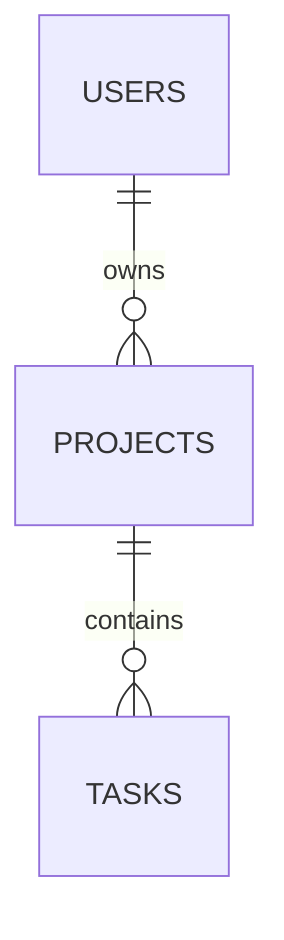

# Personal To-Do Manager — Architecture (MVP)

Status: **P0 approved; P1 in progress.**
Sources: `docs/requirements.md`, `docs/personal-todo-manager-architecture.md`, `CLAUDE.md`.
Decisions: `docs/adr/`.

---

## 1. Requirements analysis

**Functional**

| Area | Requirements |
|---|---|
| Auth | Google OIDC + GitHub OAuth only; logout; session survives refresh; profile (provider, provider_user_id, email?, display_name, avatar_url?) |
| Projects | Create, rename, delete (block until empty, see §2) |
| Tasks | Title, description, status (TODO/IN_PROGRESS/DONE), due date, priority (LOW/MEDIUM/HIGH); create, edit, delete, quick status change |
| Search/filter | Title+description search; filter by status, priority, due category (overdue/today/next 7 days/all) |
| Realtime | Authenticated WebSocket; initial batch on connect; periodic check; overdue + due-soon types; ≥1 client→server message (SUBSCRIBE) |
| UI | Login with 2 providers; sidebar + task list; modal/drawer forms; responsive; empty/no-results/loading states; hover/focus; client validation |
| Data | Persistent DB; seed/sample data path |

**Non-functional**

| Category | Requirement | Design response |
|---|---|---|
| Security | Strict per-user isolation, REST and WS | Owner-scoped queries, 404 for foreign resources, identity from session only |
| Security | Secure session, CSRF, WS origin check | HttpOnly/SameSite cookies, CSRF on mutations, origin allowlist |
| Correctness | Consistent date rules across filters and notifications | Single `TaskDateRules` with injected `Clock` |
| Reliability | Reconnect; no stale notifications | Bounded backoff; diff-based batches; socket close on session end |
| Quality | Automated tests for critical flows | Testcontainers MySQL, stub OAuth provider, in-process WS client |
| Operability | Reproducible local run | Docker Compose (optional) + documented non-container path |
| Scale | MVP, one instance | Sessions and WS registry in-memory; no distribution |

## 2. Ambiguities and decisions

| # | Topic | Ambiguity | Decision | Needs confirmation |
|---|---|---|---|---|
| A1 | Project delete | Requirements say both "cascade" and "block until empty" | **Block until empty**: delete returns 409 while tasks exist; user deletes tasks first (ADR-004) | Decided |
| A2 | Due soon | "Within next 3 days, inclusive" — today included? | `today ≤ due ≤ today+3`, status ≠ DONE | Decided |
| A3 | Next 7 days | Source doc's `today..today+7` yields 8 dates | `today ≤ due ≤ today+6` (7 calendar days) | Decided |
| A4 | Overdue | Applies to Done tasks? | No: `due < today AND status ≠ DONE` | No |
| A5 | "Today" category | Include Done tasks? | Yes (status-agnostic) | No |
| A6 | Client message | Subscribe, ack, or both? | `SUBSCRIBE` only (ack deferred) | No |
| A7 | Push policy | Push every 60 s or only on change? | Check every 60 s; push only if the per-connection batch changed; empty batch clears stale state | Yes |
| A8 | Timezone | Source says UTC default + optional browser zone | Browser IANA zone sent via `PATCH /me/preferences` when it differs from stored value | No |
| A9 | Missing email | GitHub private email; Google unverified email | Email nullable. Google: store only if `email_verified=true`. GitHub: `read:user` scope only; email from public profile if present | No |
| A10 | Session timeout | Not specified | Idle timeout 8 h (`server.servlet.session.timeout=8h`) | Decided |
| A11 | Task edit concurrency | Stale edits from two tabs | `version` required on PATCH; mismatch → 409 | No |
| A12 | Duplicate project names | Not specified | Allowed | No |
| A13 | Move task between projects | Not in requirements | Not supported in MVP | No |
| A14 | Field limits | Not specified | title 255, description 10 000, project name 150 | No |
| A15 | Sample data | "Development-only" | `POST /api/v1/dev/sample-data`, active only in `dev` profile; idempotent per user | No |

## 3. Security risks and mitigations

| Risk | Mitigation |
|---|---|
| Cross-site WebSocket hijacking | Handshake requires session cookie **and** `Origin` ∈ allowlist (`APP_BASE_URL`); else 403 |
| OAuth CSRF / code injection | Spring OAuth2 `state` + PKCE for both providers |
| Open redirect after login | Success redirect fixed to `APP_BASE_URL`; no `returnUrl` parameter |
| Account takeover via email | Identity = `(provider, provider_user_id)`; no email-based linking; unverified Google email not stored |
| IDOR / BOLA | Owner-scoped repository methods; user ID only from `SecurityContext`; 404 for foreign resources |
| Mass assignment | DTOs without `userId`/`projectId` owner fields; unknown JSON properties rejected |
| SQL injection / LIKE wildcards | JPA Specifications, bound parameters, `%`/`_`/`\` escaped in search |
| Sort injection / unbounded paging | Sort allowlist; `size` ≤ 100 |
| Stored XSS | React escaping only; no `dangerouslySetInnerHTML`; CSP header |
| Session fixation | Spring default session ID change on login |
| Socket outlives session | `SessionDestroyedEvent` closes sockets (code 4401); scheduler sweep validates sessions as fallback |
| WS flooding / oversized frames | Max text frame 4 KB; ≤ 10 messages per 10 s per connection; violation closes socket |
| Information leakage | ProblemDetail only; `server.error.include-stacktrace=never`; no internal messages on 500 |
| Dev endpoints / Swagger in prod | Gated by `dev` profile; actuator exposes `health` only |
| Secret exposure | Secrets via env only; `.env` git-ignored; `.env.example` has placeholders only |
| Cookie theft | `HttpOnly`, `Secure` (non-dev), `SameSite=Lax` |
| Login CSRF on API | CSRF token on all state-changing requests including logout |

## 4. Module structure

### 4.1 Backend (package by feature, layered)

```text
backend/src/main/java/com/todomanager/
├── auth/        config/ oauth/ (profile mappers, upsert) principal/ (AppUserPrincipal)
├── user/        controller/ service/ repository/ entity/ dto/        (profile, preferences)
├── project/     controller/ service/ repository/ entity/ dto/
├── task/        controller/ service/ repository/ specification/ entity/ dto/
│                  └─ TaskDateRules.java   (single source for date predicates)
├── notification/ websocket/ (Handler, Registry, Config, Interceptor)
│                 scheduler/ (NotificationScheduler)
│                 service/   (NotificationService — builds per-user batches)
│                 dto/
└── common/      config/ exception/ (ProblemDetail advice) security/ time/ (Clock bean)
```

Rules:
- Controller → Service → Repository. Controllers hold no business logic.
- Cross-feature access goes through services (e.g., `notification` calls `TaskQueryService`, never `TaskRepository` directly).
- DTOs at the API boundary; entities never serialized.
- Constructor injection only; no field injection.

### 4.2 Frontend (feature-based SPA)

```text
frontend/src/
├── app/           router.tsx providers.tsx (QueryClient, Notification context)
├── pages/         LoginPage.tsx DashboardPage.tsx
├── features/
│   ├── auth/      api hooks (useMe, logout), RequireAuth guard
│   ├── projects/  api/ components/ (ProjectSidebar, CreateProjectDialog, DeleteProjectDialog) hooks/ types/
│   ├── tasks/     api/ components/ (TaskToolbar, TaskList, TaskListItem, TaskFormDialog, TaskFilters) hooks/ schemas/ types/
│   └── notifications/ components/ (NotificationBell, NotificationPanel, ConnectionStatus) hooks/ websocket/ (client, reconnect)
├── components/{ui,layout}/   shadcn/ui primitives; AppLayout, Header
└── lib/           api-client.ts (fetch wrapper, CSRF header, 401 handling), query-client.ts
```

## 5. Data model (MySQL 8.0, Flyway)



```sql
-- V1__init.sql
CREATE TABLE users (
    id               BINARY(16)    NOT NULL PRIMARY KEY,   -- UUID
    provider         VARCHAR(20)   NOT NULL,
    provider_user_id VARCHAR(255)  NOT NULL,               -- Google sub / GitHub numeric id
    email            VARCHAR(255)  NULL,
    display_name     VARCHAR(255)  NOT NULL,
    avatar_url       VARCHAR(2048) NULL,
    timezone         VARCHAR(64)   NOT NULL DEFAULT 'UTC',
    created_at       DATETIME(6)   NOT NULL,                -- stored in UTC
    last_login_at    DATETIME(6)   NOT NULL,
    CONSTRAINT uk_users_identity UNIQUE (provider, provider_user_id),
    CONSTRAINT ck_users_provider CHECK (provider IN ('GOOGLE', 'GITHUB'))
) ENGINE=InnoDB DEFAULT CHARSET=utf8mb4;

CREATE TABLE projects (
    id         BINARY(16)   NOT NULL PRIMARY KEY,
    user_id    BINARY(16)   NOT NULL,
    name       VARCHAR(150) NOT NULL,
    created_at DATETIME(6)  NOT NULL,
    updated_at DATETIME(6)  NOT NULL,
    CONSTRAINT fk_projects_user FOREIGN KEY (user_id) REFERENCES users (id),
    INDEX idx_projects_user (user_id)
) ENGINE=InnoDB DEFAULT CHARSET=utf8mb4;

CREATE TABLE tasks (
    id          BINARY(16)   NOT NULL PRIMARY KEY,
    project_id  BINARY(16)   NOT NULL,
    title       VARCHAR(255) NOT NULL,
    description TEXT         NULL,
    status      VARCHAR(20)  NOT NULL DEFAULT 'TODO',
    priority    VARCHAR(20)  NOT NULL DEFAULT 'MEDIUM',
    due_date    DATE         NULL,
    created_at  DATETIME(6)  NOT NULL,
    updated_at  DATETIME(6)  NOT NULL,
    version     BIGINT       NOT NULL DEFAULT 0,
    CONSTRAINT fk_tasks_project FOREIGN KEY (project_id) REFERENCES projects (id) ON DELETE RESTRICT,
    CONSTRAINT ck_tasks_status CHECK (status IN ('TODO', 'IN_PROGRESS', 'DONE')),
    CONSTRAINT ck_tasks_priority CHECK (priority IN ('LOW', 'MEDIUM', 'HIGH')),
    INDEX idx_tasks_project_status_due (project_id, status, due_date)
) ENGINE=InnoDB DEFAULT CHARSET=utf8mb4;
```

Notes:
- UUIDs as `BINARY(16)` (Hibernate 6 default for `UUID` on MySQL); MySQL has no `TIMESTAMPTZ`, so timestamps are `DATETIME(6)` in UTC (`hibernate.jdbc.time_zone=UTC`).
- Enums persisted as strings with CHECK constraints.
- `ddl-auto=validate`; Flyway owns the schema.
- Owner check on tasks goes through `projects.user_id` (no denormalized `user_id` on tasks).

## 6. Authentication

### 6.1 Login flows

Spring Security `oauth2Login` with two registrations:

| | Google | GitHub |
|---|---|---|
| Protocol | OIDC (`openid profile email`) | OAuth 2.0 (`read:user`) |
| Start URL | `/oauth2/authorization/google` | `/oauth2/authorization/github` |
| Callback | `${APP_BASE_URL}/login/oauth2/code/google` | `${APP_BASE_URL}/login/oauth2/code/github` |
| `provider_user_id` | `sub` (ID token, validated) | `id` (as string) |
| Email | `email` only if `email_verified=true` | `email` if public, else null |
| Display name fallback | `name` → email local part | `name` → `login` |
| Avatar | `picture` | `avatar_url` |

Flow: browser → `/oauth2/authorization/{p}` → provider (state + PKCE) → callback → `OAuthUserProfileMapper` (Strategy: `GoogleUserProfileMapper`, `GitHubUserProfileMapper`) → upsert user → session principal `AppUserPrincipal(userId, provider, providerUserId)` → redirect to `APP_BASE_URL/`.

Upsert: `INSERT` guarded by the unique key; on `DuplicateKeyException` re-read and update. Updates `display_name`, `email`, `avatar_url`, `last_login_at` on each login.

### 6.2 Session

- Server-side HTTP session, cookie `JSESSIONID`, `HttpOnly`, `SameSite=Lax`, `Secure` outside `dev`.
- Session ID rotates on login (Spring default); logout invalidates session and deletes cookie.
- `HttpSessionEventPublisher` enabled; `SessionDestroyedEvent` (logout or timeout) closes matching WebSockets.
- Unauthenticated `/api/**` → `401` ProblemDetail via custom `AuthenticationEntryPoint` (never a redirect).
- `server.forward-headers-strategy=framework` behind Vite/Nginx proxies.

### 6.3 CSRF

- `CookieCsrfTokenRepository.withHttpOnlyFalse()`; header `X-XSRF-TOKEN`.
- `GET /api/v1/csrf` returns the token and forces it into the cookie.
- Required on all `POST/PATCH/DELETE`, including `/api/v1/logout`. Missing/invalid → 403.

### 6.4 Frontend session behavior

- On load: `GET /api/v1/me`. `200` → app; `401` → `/login`.
- Session persists across refresh because the cookie is server-backed.
- Logout: `POST /api/v1/logout` → clear TanStack Query cache, close WebSocket, stop reconnect, navigate to `/login`.

## 7. Authorization

Rules:
1. Identity source: `@AuthenticationPrincipal AppUserPrincipal` only. Never from body, query, path, or WS payload.
2. Every query is owner-scoped:
   - `ProjectRepository.findByIdAndUserId(projectId, userId)`
   - `TaskRepository.findByIdAndProject_UserId(taskId, userId)`
   - Search via `TaskSpecification.belongsToUser(userId)` as the first predicate.
3. Create task: verify project ownership first (`findByIdAndUserId`); foreign project → 404.
4. Foreign or missing resource → 404 (no existence leak). Unauthenticated → 401. CSRF failure → 403.
5. WebSocket: principal from handshake session; registry keys connections by user ID; notifications computed per user only.
6. No sharing, invitations, or public links (no endpoints, no tokens, no routes).

## 8. REST API (`/api/v1`)

| Method | Path | Auth | Notes |
|---|---|---|---|
| GET | `/me` | session | Profile + timezone |
| GET | `/csrf` | public | Issues CSRF token |
| PATCH | `/me/preferences` | session | `{ timezone }` (IANA ID validated) |
| POST | `/logout` | session + CSRF | 204; closes WS |
| GET | `/projects` | session | Own projects, with `taskCount` |
| POST | `/projects` | session + CSRF | `{ name }` → 201 |
| GET | `/projects/{id}` | session | 404 if not owned |
| PATCH | `/projects/{id}` | session + CSRF | `{ name }` |
| DELETE | `/projects/{id}` | session + CSRF | 204 if empty; 409 if tasks exist |
| GET | `/tasks` | session | Filters: `projectId, search, status, priority, due, page, size, sort` |
| POST | `/projects/{id}/tasks` | session + CSRF | 201; project must be owned |
| GET | `/tasks/{id}` | session | 404 if not owned |
| PATCH | `/tasks/{id}` | session + CSRF | Full editable form: `title, description, status, priority, dueDate, version` |
| PATCH | `/tasks/{id}/status` | session + CSRF | `{ status, version }` |
| DELETE | `/tasks/{id}` | session + CSRF | 204 |
| POST | `/dev/sample-data` | session + CSRF | `dev` profile only; 404 elsewhere |

Contracts:
- Task DTO: `id, projectId, title, description, status, priority, dueDate (YYYY-MM-DD | null), createdAt, updatedAt, version`.
- List response: `{ content, page, size, totalElements, totalPages }`. `size` max 100, default 20.
- Sort allowlist: `dueDate, priority, createdAt, title, status`. Default `dueDate,asc` with nulls last.
- `due` ∈ `OVERDUE | TODAY | NEXT_7_DAYS | ALL` (default `ALL`). `status`/`priority` enum validated.
- Search: case-insensitive, `title OR description`, wildcards escaped.
- Errors: `application/problem+json`; 400 with `errors` map; 401; 403; 404; 409 (`version` mismatch); 500 generic.
- OpenAPI via springdoc at `/v3/api-docs`, Swagger UI only in `dev`.

## 9. Date rules

Evaluated in the user's timezone (`users.timezone`, default UTC). `TaskDateRules` receives `Clock` and computes `today = LocalDate.now(clock.withZone(userZone))`.

| Category | Predicate |
|---|---|
| Overdue | `due_date < today AND status ≠ DONE` |
| Today | `due_date = today` |
| Due soon | `today ≤ due_date ≤ today+3 AND status ≠ DONE` |
| Next 7 days | `today ≤ due_date ≤ today+6` |
| All | no restriction |

Null due dates match only "All".

## 10. WebSocket protocol

### 10.1 Connection

- Endpoint: `/ws/notifications` (text JSON frames).
- Handshake interceptor checks, in order: `Origin` ∈ allowlist → else 403; session principal present → else 401; then upgrade.
- Max text frame: 4 KB. Idle-ping every 30 s.

### 10.2 Messages

Envelope: `{ "type": "<TYPE>", "payload": { ... } }`

Client → Server

```json
{ "type": "SUBSCRIBE", "payload": { "enabledTypes": ["OVERDUE", "DUE_SOON"] } }
```
- `enabledTypes`: subset of `{OVERDUE, DUE_SOON}`, no duplicates, ≤ 2 items. Empty array = no notifications.
- Default on connect (before SUBSCRIBE): both types.
- No identity fields accepted.

Server → Client

```json
{ "type": "SUBSCRIPTION_UPDATED", "payload": { "enabledTypes": ["OVERDUE"] } }
```

```json
{
  "type": "NOTIFICATION_BATCH",
  "payload": {
    "notifications": [
      { "type": "OVERDUE", "taskId": "…", "projectId": "…", "title": "Review PR", "dueDate": "2026-11-22", "priority": "HIGH" },
      { "type": "DUE_SOON", "taskId": "…", "projectId": "…", "title": "Docs", "dueDate": "2026-11-26", "priority": "MEDIUM" }
    ]
  }
}
```

```json
{ "type": "ERROR", "payload": { "code": "INVALID_PAYLOAD", "message": "enabledTypes contains unknown value" } }
```

Error codes: `INVALID_JSON`, `UNKNOWN_TYPE`, `INVALID_PAYLOAD`, `RATE_LIMITED` (then close 1008). Oversized frame → close 1009. Session ended → close 4401 (`session-ended`). Client treats 4401 as terminal (no reconnect).

### 10.3 Lifecycle

1. Handshake accepted → register `{connectionId, userId, httpSessionId, enabledTypes=[both], lastSentFingerprint=null}`.
2. Send initial `NOTIFICATION_BATCH` (may be empty).
3. Client `SUBSCRIBE` → update prefs → `SUBSCRIPTION_UPDATED` → fresh batch for this connection.
4. Scheduler every 60 s (`notifications.interval-ms`): 
   - Collect distinct connected user IDs; validate each session is still registered (fallback sweep).
   - For each user, run one owner-scoped query (`status ≠ DONE AND due_date ≤ today+3`, joined to user's projects) and split into OVERDUE/DUE_SOON in memory.
   - Per connection: filter by `enabledTypes`; send only if the fingerprint changed; empty result sent once to clear stale state.
5. Logout/expiry → `SessionDestroyedEvent` → close all sockets for that session with 4401; remove from registry.
6. Writes are serialized per connection via `ConcurrentWebSocketSessionDecorator`. One scheduler thread total.

Registry: `ConcurrentHashMap` keyed by connection ID, secondary index by HTTP session ID and user ID.

### 10.4 Frontend client

- Single `NotificationProvider` (React Context + hook) owns the socket.
- Reconnect: exponential backoff 1 s → 30 s max, with jitter; re-send `SUBSCRIBE` with last preferences on each open.
- Stop reconnecting on logout or close code 4401.
- Panel replaces its snapshot on every batch; toast only for notifications whose `(type, taskId)` is new vs previous batch.
- Connection status indicator in header; `aria-live` region for toasts.

## 11. Frontend state and UX

| State | Mechanism |
|---|---|
| Projects, tasks, profile | TanStack Query; invalidate on mutation; query keys include user ID |
| Forms | React Hook Form + Zod (same limits as server) |
| Search/filter | URL search params (`q, status, priority, due, projectId`), debounced 300 ms |
| UI (dialogs, drawer) | `useState` |
| Notifications | Context + custom hook |

- Quick status: optimistic update with rollback; on 409, refetch and show message.
- Logout: `queryClient.clear()` and socket close.
- Routes: `/login`, `/` (all tasks), `/projects/:projectId`. Sidebar becomes shadcn `Sheet` below 768 px.
- Loading: Skeleton rows. Empty project: "No tasks yet" + create button. No results: "No tasks match your filters" + reset.
- Focus and hover states on all interactive elements; `focus-visible` ring; consistent spacing scale.

## 12. Testing strategy

| Level | Tools | Scope |
|---|---|---|
| Unit | JUnit 5, Mockito | `TaskDateRules`, mappers, validators, sort/escape helpers |
| Integration (backend) | `@SpringBootTest`, Testcontainers MySQL (`@ServiceConnection`), MockMvc | Controllers, repositories, Flyway, owner scoping |
| OAuth | Embedded WireMock as stub provider (discovery, token, userinfo, JWKS signed with test key) | Real callback exchange and provisioning; `issuer-uri`/endpoints overridden in test profile |
| WebSocket | `@SpringBootTest(RANDOM_PORT)` + Spring `WebSocketClient`; session cookie obtained via stub login | Handshake, batches, SUBSCRIBE, logout closure |
| Clock | Test `@Configuration` providing `Clock.fixed(2026-11-24T10:00:00Z)` | Deterministic dates |
| Frontend unit | Vitest, React Testing Library, MSW | Validation, filters, empty/loading states, notification updates |
| E2E | Playwright, stub provider profile `e2e` | Login both providers, create project/task, filter, notification, logout |

Required test cases (acceptance):

| Requirement | Test |
|---|---|
| SSO success path (stub) | `OAuthLoginIntegrationTest` — Google and GitHub |
| Identity uniqueness | `UserProvisioningTest` — same email across providers → 2 users; repeat login → 1 user |
| Create list + task | `ProjectIntegrationTest`, `TaskIntegrationTest` |
| Cross-account isolation | `AuthorizationIntegrationTest` — every REST operation with foreign IDs → 404 |
| WS cross-account | Other user's overdue task not delivered |
| WS notifications | Overdue, due today+3 (in), today+4 (out), done task (out), subscribe-only-overdue |
| Delete blocked | `ProjectDeleteBlockedTest` — 409 with tasks; 204 after tasks removed |
| Concurrency | Stale `version` → 409 |
| Security negatives | 401 on all `/api/**` unauthenticated; 403 missing CSRF; WS unauthenticated and bad origin rejected; logout closes socket |
| Input hardening | LIKE wildcards literal; sort allowlist; oversized WS frame; unknown WS type → ERROR |

Commands: `./mvnw verify` (backend), `npm run test -- --run` (frontend), `npx playwright test` (E2E). No test is disabled to pass a build.

## 13. Delivery and infrastructure

Local run:
- Mandatory path: `docker compose up --build` (MySQL with healthcheck + volume, backend, optional Nginx for frontend) or non-container: local MySQL 8.0, `./mvnw spring-boot:run`, `npm ci && npm run dev`.
- Vite proxies `/api`, `/oauth2`, `/login/oauth2`, `/ws` (WS upgrade enabled) → same-origin; `APP_BASE_URL=http://localhost:5173`.

`.env.example` (no secrets):

```dotenv
MYSQL_HOST=localhost
MYSQL_PORT=3306
MYSQL_DB=todo_manager
MYSQL_USER=todo_user
MYSQL_PASSWORD=
GOOGLE_CLIENT_ID=
GOOGLE_CLIENT_SECRET=
GITHUB_CLIENT_ID=
GITHUB_CLIENT_SECRET=
APP_BASE_URL=http://localhost:5173
NOTIFICATION_INTERVAL_MS=60000
SPRING_PROFILES_ACTIVE=dev
```

Spring profiles:
- `dev`: Swagger UI, sample-data endpoint, cookies non-Secure.
- `prod`: Swagger off, Secure cookies, `include-stacktrace=never`, actuator `health` only.
- `e2e` / `test`: provider endpoints point to WireMock.

CI (`.github/workflows/ci.yml`):
1. `validate`: ESLint, `tsc --noEmit`, Prettier check.
2. `backend-test` and `frontend-test` in parallel (Testcontainers needs Docker on runner).
3. `build`: backend JAR, frontend bundle.
4. `e2e`: Playwright with stub provider.
5. Optional: Docker image build.

No provider secrets in repo or CI logs; OAuth credentials for manual verification only.

## 14. Phased implementation plan

| Phase | Scope | Depends on | Acceptance criteria |
|---|---|---|---|
| **P0 Review** | This document + ADRs; confirm A1–A3, A7, A10 | — | Approval recorded |
| **P1 Foundation** | Monorepo layout; Spring Boot skeleton; Flyway V1; MySQL via Compose; Vite + React + Tailwind + shadcn skeleton with proxy; CI skeleton; `.env.example`; `.gitignore` | P0 | `./mvnw verify` runs a Testcontainers smoke test; `npm run build` passes; `docker compose up` healthy; Flyway validates on empty DB |
| **P2 Authentication** | Google OIDC + GitHub OAuth; profile mappers; upsert; session; `/me`, `/csrf`, `/logout`; 401 JSON; login page | P1 | Stub-provider tests pass for both providers; identity uniqueness test; unverified Google email not stored; after logout `/me` → 401; session survives reload (manual or E2E) |
| **P3 Projects & Tasks** | Entities, repos (owner-scoped), services, REST, DTO validation, quick status, optimistic locking, block-on-delete | P2 | Integration tests for CRUD; every endpoint returns 404 for foreign IDs; delete-blocked test; stale `version` → 409; invalid input → 400 with field errors |
| **P4 Search & Dashboard UI** | JPA Specifications; `TaskDateRules`; task list UI, filters, search, forms (RHF + Zod), responsive layout, empty/loading states | P3 | Combined-filter tests; date-category tests with fixed Clock; LIKE escape test; RTL tests for validation and empty/no-results; usable at 375 px width |
| **P5 WebSocket Notifications** | Handshake auth + origin check; registry; scheduler; SUBSCRIBE; batches; session-end close; client provider, bell, panel, toasts, reconnect | P3 (P4 UI parallel) | All rows of WS scenario table pass; logout closes socket; reconnect re-subscribes; no duplicate toasts |
| **P6 Quality & Delivery** | Playwright E2E; sample data (dev); springdoc; Dockerfile; README (OAuth setup, WS formats, rules, test commands, run steps); CI green | P4, P5 | Requirements §8 acceptance checklist met; README sufficient for a new developer; `./mvnw verify` and `npx playwright test` pass |

Each phase: small reviewable commits, tests green before moving on, security checklist reviewed, docs updated.

## 15. Corrections to the source architecture doc

Found while writing this document; the source doc (`docs/personal-todo-manager-architecture.md`) should be updated:
- MySQL port is **3306**, not 5432 (§11 diagram).
- MySQL has no `TIMESTAMPTZ`; use `DATETIME(6)` UTC.
- "Next 7 days" as `today..today+7` gives 8 dates; this document uses 7 (A3).
- CI path is `.github/workflows/`, not `.GitHub-ci.yml`.
- Provider values stored as `GOOGLE` / `GITHUB` enums.
- Stray non-English fragment in §3 ("для").

## 16. Architecture Decision Records

| ADR | Title | Status |
|---|---|---|
| [001](adr/001-modular-monolith.md) | Modular monolith, package by feature | Proposed |
| [002](adr/002-session-authentication.md) | Server-side HTTP session authentication | Proposed |
| [003](adr/003-raw-websocket.md) | Raw WebSocket with JSON | Proposed |
| [004](adr/004-cascade-delete.md) | Block delete of non-empty projects | Accepted |
| [005](adr/005-mysql-flyway-optimistic-locking.md) | MySQL, Flyway, optimistic locking | Proposed |
| [006](adr/006-date-and-timezone-rules.md) | Date category rules and timezone handling | Proposed |

## 17. Open questions for approval

1. ~~A1~~ Resolved: block until empty.
2. ~~A2~~ Resolved: due soon includes today.
3. ~~A3~~ Resolved: next 7 days = 7 calendar days (today..today+6).
4. **A7** Push only on change (proposed) or every 60 s regardless?
5. ~~A10~~ Resolved: 8 h idle timeout.
