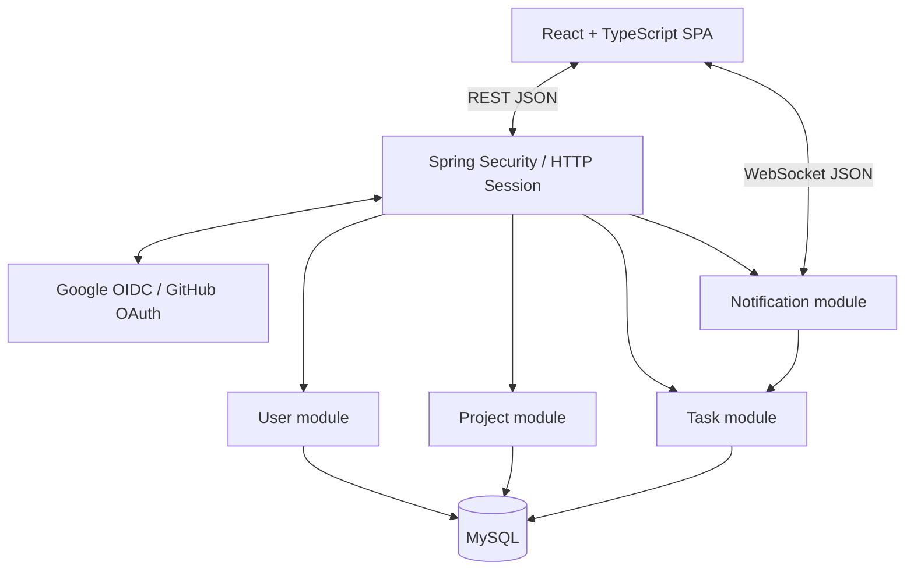
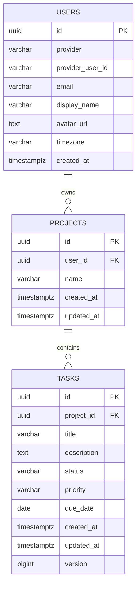
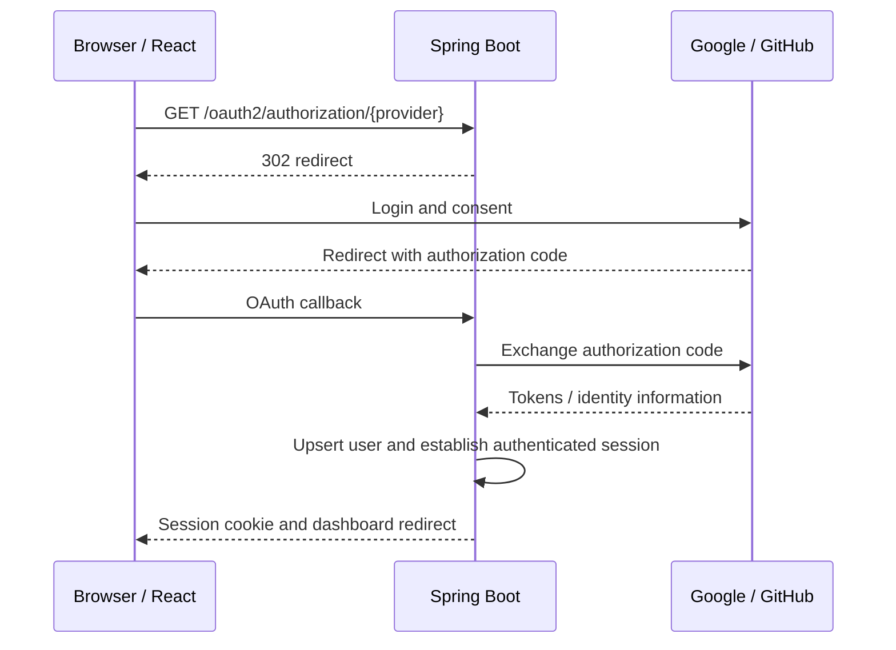
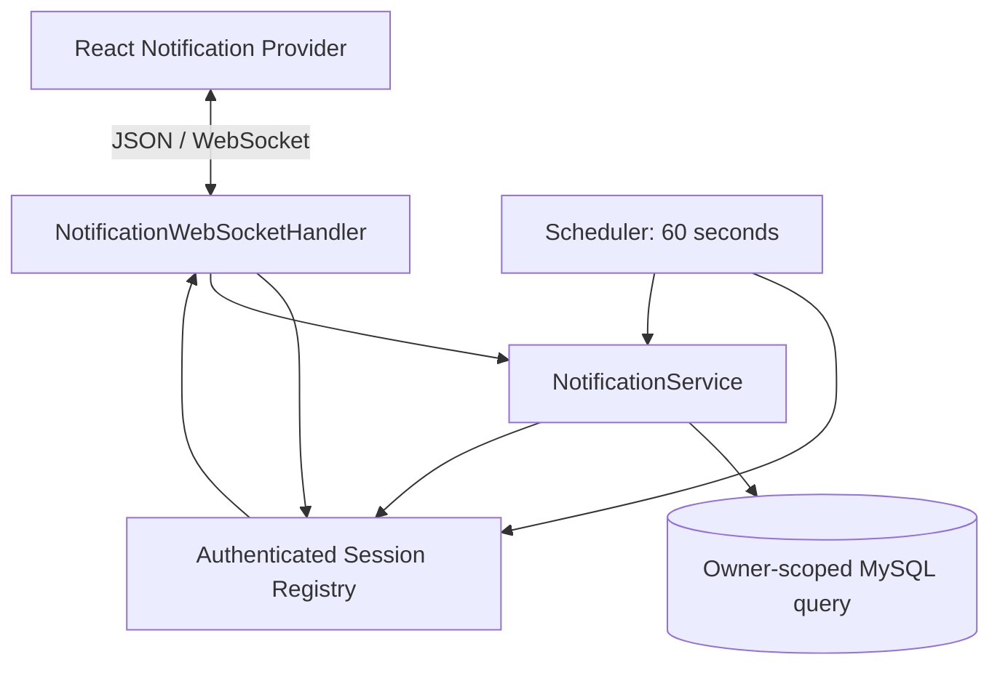
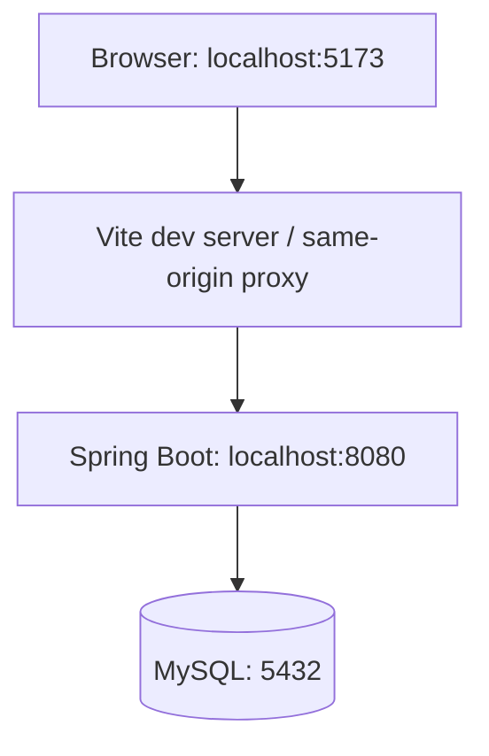

# Personal To-Do Manager — Architecture & Implementation Plan

MVP architecture document for development using Claude Code. The goal is to implement a full-fledged multi-user web application, including a frontend, backend, data persistence, SSO, two-way WebSocket communication, tests, and a reproducible local setup.
## 1. Technology stack

| Component | Technology |
|---|---|
| Language | Java 21 LTS |
| Backend | Spring Boot, Spring MVC |
| Security | Spring Security, OAuth2 Client |
| Real-time | Spring WebSocket, native browser WebSocket |
| Persistence | MySQL, Spring Data JPA, Hibernate |
| Migrations | Flyway |
| Validation | Jakarta Bean Validation |
| API documentation | OpenAPI / Swagger UI |
| Build | Maven Wrapper |
| Frontend | React, TypeScript, Vite |
| UI | shadcn/ui, Tailwind CSS |
| Server state | TanStack Query |
| Routing | React Router |
| Forms | React Hook Form, Zod |
| Backend tests | JUnit 5, Mockito, Testcontainers, stub OAuth provider |
| Frontend tests | Vitest, React Testing Library |
| E2E | Playwright |
| Infrastructure | Docker Compose, optional Nginx |
| CI | github actions |
| AI development | Claude Code |

Java 21 is a mature LTS version; other dependencies should be pinned to compatible, stable releases. Spring Security provides OAuth/OIDC mechanisms, while Spring WebSocket supports HTTP-session-based authentication. There is no need to implement security protocols from scratch.
## 2. Architecture

### 2.1 High-level architecture

Modular Monolith + SPA. A single backend, a single database, a single frontend, and two external Identity Providers.



Do not use microservices, Kafka, RabbitMQ, Redis, Kubernetes, GraphQL, Redux, Elasticsearch, or Keycloak; the scale and requirements of an MVP do not justify such additional infrastructure. MySQL can handle search, TanStack Query can manage server state, and Spring Scheduler can take care of periodic notifications. These choices can be revisited if the load increases.

### 2.2 Backend: Package by Feature + Layered Architecture

```text
backend/
├── pom.xml
└── src/
    ├── main/
    │   ├── java/com/todomanager/
    │   │   ├── TodoManagerApplication.java
    │   │   ├── auth/{config,oauth,principal}/
    │   │   ├── user/{controller,service,repository,entity,dto}/
    │   │   ├── project/{controller,service,repository,entity,dto}/
    │   │   ├── task/{controller,service,repository,specification,entity,dto}/
    │   │   ├── notification/{websocket,scheduler,service,dto}/
    │   │   └── common/{config,exception,security}/
    │   └── resources/
    │       ├── application.yml
    │       └── db/migration/
    └── test/
```

Controller → Service → Repository → MySQL.

- Controller: HTTP, DTOs, validation; contains no business logic.
- Service: business rules, authorization, transactions.
- Repository: persistence, with mandatory scoping of queries to the owner.
- Do not expose JPA entities directly via the API; use DTOs.
- Use constructor injection; avoid implementing a full-blown Hexagonal/Clean Architecture with numerous ports and adapters unless necessary.

## 3. Database design



### 3.1 SQL migration example

```sql
CREATE TABLE users (
    id UUID PRIMARY KEY,
    provider VARCHAR(20) NOT NULL,
    provider_user_id VARCHAR(255) NOT NULL,
    email VARCHAR(255),
    display_name VARCHAR(255) NOT NULL,
    avatar_url TEXT,
    timezone VARCHAR(64) NOT NULL DEFAULT 'UTC',
    created_at TIMESTAMPTZ NOT NULL DEFAULT NOW(),
    UNIQUE (provider, provider_user_id)
);

CREATE TABLE projects (
    id UUID PRIMARY KEY,
    user_id UUID NOT NULL REFERENCES users(id),
    name VARCHAR(150) NOT NULL,
    created_at TIMESTAMPTZ NOT NULL DEFAULT NOW(),
    updated_at TIMESTAMPTZ NOT NULL DEFAULT NOW()
);
CREATE INDEX idx_projects_user ON projects(user_id);

CREATE TABLE tasks (
    id UUID PRIMARY KEY,
    project_id UUID NOT NULL REFERENCES projects(id) ON DELETE CASCADE,
    title VARCHAR(255) NOT NULL,
    description TEXT,
    status VARCHAR(20) NOT NULL DEFAULT 'TODO',
    priority VARCHAR(20) NOT NULL DEFAULT 'MEDIUM',
    due_date DATE,
    created_at TIMESTAMPTZ NOT NULL DEFAULT NOW(),
    updated_at TIMESTAMPTZ NOT NULL DEFAULT NOW(),
    version BIGINT NOT NULL DEFAULT 0,
    CHECK (status IN ('TODO', 'IN_PROGRESS', 'DONE')),
    CHECK (priority IN ('LOW', 'MEDIUM', 'HIGH'))
);
CREATE INDEX idx_tasks_project ON tasks(project_id);
CREATE INDEX idx_tasks_project_due_date ON tasks(project_id, due_date);
CREATE INDEX idx_tasks_project_status ON tasks(project_id, status);
```

- UUID primary keys; Java enums + SQL CHECK; LocalDate / DATE for deadline; Instant / TIMESTAMPTZ for timestamps.
- Flyway migrations, Hibernate DDL `validate`.
- Use `@Version` for optimistic locking; if you need to detect stale client-side updates, include the version in your DTOs or use ETag/If-Match headers.
- Implement cascade deletion for projects, including a confirmation dialog that warns the user that all associated tasks will also be deleted.
- Notification history is not persisted in the MVP.
- User identity is determined by the pair `(provider, provider_user_id)` rather than by email. An email address may be missing or subject to change. Accounts from different providers (e.g., Google and GitHub) are not automatically merged, even if they share the same email address.

## 4. Authentication & Security

### 4.1 OAuth Authorization Code Flow + server-side HTTP session



Google uses OpenID Connect (`sub`), while GitHub uses OAuth 2.0 (`id`). The browser does not store OAuth access/refresh tokens.

| Criterion | HTTP session | JWT |
|---|---|---|
| Logout | Invalidate session | Revocation strategy required |
| Refresh | No app token refresh logic | Additional logic |
| WebSocket | Reuse handshake principal | Additional token mechanism |
| Browser | HttpOnly cookie | Safe storage strategy required |
| Scaling | Shared session or sticky sessions | Potentially simpler |
| MVP complexity | Low | Higher |

Choice: HTTP session for a single backend instance.

### 4.2 Endpoints and provisioning

```text
GET /oauth2/authorization/google
GET /oauth2/authorization/github
GET /login/oauth2/code/google
GET /login/oauth2/code/github
```

```typescript
window.location.href = '/oauth2/authorization/google';
```

Upon a successful login: retrieve the profile, normalize it, locate or create a user based on a composite identity, update the profile, and generate an authenticated principal with an internal UUID. If a display name is missing, apply the documented fallback (e.g., the GitHub login).

```java
public record OAuthUserProfile(
    AuthProvider provider,
    String providerUserId,
    String email,
    String displayName,
    String avatarUrl
) {}
```

Strategy Pattern: `OAuthUserProfileMapper`, `GoogleUserProfileMapper`, `GitHubUserProfileMapper`. For concurrent provisioning, use a unique constraint along with a safe upsert/retry mechanism.

### 4.3 Security requirements

- Use `HttpOnly` session cookies, set the `Secure` flag in production, and apply `SameSite=Lax`.
- Implement CSRF protection for state-changing REST requests and logout operations; issue a fresh CSRF token upon login/logout.
- Utilize Spring Security for OAuth `state` management, OIDC validation, and protection against session fixation.
- For WebSocket handshakes: ensure an authenticated principal is present, enforce an explicit allowlist for the `Origin` header, and never accept a user ID provided by the client.
- Store OAuth secrets exclusively in environment variables; never commit `.env` files to version control.
- Ensure unauthenticated API responses return a `401` status code rather than an HTML redirect.
- Close WebSocket connections upon logout or HTTP session expiration—handshake-based authentication does not automatically revoke an already established socket. The registry must link each connection to its corresponding HTTP session and verify its ongoing validity.
- Use HTTPS/WSS in production. Ensure user-provided data is rendered securely, avoiding the inclusion of raw HTML.

## 5. Data isolation / Authorization

Protection against IDOR / BOLA: every operation is restricted to the current user. A UUID, by itself, is not an authorization mechanism. The User ID is retrieved from the Security Context, rather than from the request body, query parameters, or a WebSocket payload.

```java
public interface ProjectRepository extends JpaRepository<Project, UUID> {
    List<Project> findAllByUserId(UUID userId);
    Optional<Project> findByIdAndUserId(UUID projectId, UUID userId);
}

public interface TaskRepository extends JpaRepository<Task, UUID>,
        JpaSpecificationExecutor<Task> {
    Optional<Task> findByIdAndProjectUserId(UUID taskId, UUID userId);
}
```

Instead of `findById(taskId)`, use an owner-scoped query. When creating a task, verify ownership of the project; for lookups and notifications, always include an ownership predicate. If changing the `projectId` (if supported), verify both projects. A missing or inaccessible resource (belonging to someone else) should result in a 404; an unauthenticated request should result in a 401. No sharing, invitations, or public links are permitted.

## 6. REST API

Base path: `/api/v1`.

| Method | Endpoint | Purpose |
|---|---|---|
| GET | /api/v1/me | Current profile |
| GET | /api/v1/csrf | CSRF token |
| PATCH | /api/v1/me/preferences | Update timezone |
| POST | /api/v1/logout | Logout |
| GET | /api/v1/projects | List own projects |
| POST | /api/v1/projects | Create project |
| GET | /api/v1/projects/{id} | Read project |
| PATCH | /api/v1/projects/{id} | Rename project |
| DELETE | /api/v1/projects/{id} | Delete project and tasks |
| GET | /api/v1/tasks | Search/filter own tasks |
| POST | /api/v1/projects/{id}/tasks | Create task |
| GET | /api/v1/tasks/{id} | Read task |
| PATCH | /api/v1/tasks/{id} | Edit task fields |
| PATCH | /api/v1/tasks/{id}/status | Quick status change |
| DELETE | /api/v1/tasks/{id} | Delete task |

### 6.1 Search and filtering

```http
GET /api/v1/tasks?projectId=123&search=payment&status=IN_PROGRESS&priority=HIGH&due=NEXT_7_DAYS&page=0&size=20&sort=dueDate,asc
```

```java
Specification<Task> specification =
    TaskSpecification.belongsToUser(currentUserId)
        .and(TaskSpecification.belongsToProject(projectId))
        .and(TaskSpecification.matchesSearch(search))
        .and(TaskSpecification.hasStatus(status))
        .and(TaskSpecification.hasPriority(priority))
        .and(TaskSpecification.hasDueCategory(due));
```

Optional filters must be neutral when absent, but the owner predicate is mandatory. Case-insensitive title/description search is sufficient; use parameterized predicates, escape LIKE wildcards for literal search, bound page size and allowlist sort fields. Later: `pg_trgm` or full-text search if necessary.

### 6.2 Error handling

`@RestControllerAdvice` + Spring `ProblemDetail`, including field validation errors.

```json
{
  "type": "about:blank",
  "title": "Validation failed",
  "status": 400,
  "detail": "One or more fields are invalid",
  "errors": {
    "title": "Title must not be blank",
    "priority": "Invalid priority"
  }
}
```

| HTTP | Meaning |
|---|---|
| 400 | Validation error |
| 401 | Unauthenticated |
| 403 | CSRF / forbidden action |
| 404 | Missing or not-owned resource |
| 409 | Concurrent update conflict |
| 500 | Unexpected internal error; no internal details leaked |

## 7. WebSocket architecture

### 7.1 Raw WebSocket + JSON vs STOMP

Raw WebSocket is native to browsers and sufficient for one authenticated personal notification channel. STOMP offers built-in routing and subscriptions, but introduces additional protocol and library complexity. No external message broker is required.



```text
notification/
├── websocket/
│   ├── WebSocketConfig.java
│   ├── NotificationWebSocketHandler.java
│   └── WebSocketSessionRegistry.java
├── scheduler/NotificationScheduler.java
├── service/NotificationService.java
└── dto/
    ├── NotificationBatch.java
    ├── TaskNotification.java
    └── SubscriptionMessage.java
```

### 7.2 Protocol

Endpoint: `/ws/notifications`. Authenticate through HTTP session at handshake; allow only trusted origins.

Client → Server:

```json
{
  "type": "SUBSCRIBE",
  "payload": {
    "enabledTypes": ["OVERDUE", "DUE_SOON"]
  }
}
```

Server acknowledgment:

```json
{
  "type": "SUBSCRIPTION_UPDATED",
  "payload": {
    "enabledTypes": ["OVERDUE", "DUE_SOON"]
  }
}
```

Server → Client:

```json
{
  "type": "NOTIFICATION_BATCH",
  "payload": {
    "notifications": [
      {
        "type": "OVERDUE",
        "taskId": "task-uuid-1",
        "projectId": "project-uuid-1",
        "title": "Review pull request",
        "dueDate": "2026-11-22",
        "priority": "HIGH"
      },
      {
        "type": "DUE_SOON",
        "taskId": "task-uuid-2",
        "projectId": "project-uuid-1",
        "title": "Prepare documentation",
        "dueDate": "2026-11-26",
        "priority": "MEDIUM"
      }
    ]
  }
}
```

`ERROR` message for invalid client messages. Validate message type, allowed enum values, size and rate. Subscription modifies server behavior: sending only `OVERDUE` excludes due-soon notifications from subsequent batches. Default: both types. Empty enabledTypes disables notifications. Send a fresh filtered batch after subscription changes, including empty batches to clear stale state. Never accept user identity in the subscription payload.

### 7.3 Lifecycle

1. Authenticate connection and register user UUID, HTTP session ID and preferences.
2. Immediately send an initial notification batch.
3. Client sends SUBSCRIBE; validate and update preferences.
4. A single scheduler checks connected users every 60 seconds.
5. Query only each user's tasks and fan out to their connections, respecting per-connection preferences.
6. Close sockets upon session invalidation/expiry and remove disconnected sessions from registry.

```java
@Scheduled(fixedDelayString = "${notifications.interval-ms:60000}")
public void checkNotifications() {
    // Process active authenticated users
}
```

Use a thread-safe registry and serialized writes per connection, e.g. `ConcurrentWebSocketSessionDecorator`. Do not create one scheduler thread per user. If multiple tabs are connected, reuse the user-scoped query result. On frontend implement reconnect with bounded exponential backoff and stop reconnecting on logout. Resubscribe after reconnect. Notification panel replaces its snapshot on each batch; toast only for new notifications to avoid repeated alerts.

### 7.4 Date business rules

| Category | Predicate |
|---|---|
| Overdue | dueDate before today AND status != DONE |
| Today | dueDate == today |
| Due soon | today through today + 3 days, inclusive, AND status != DONE |
| Next 7 days | today through today + 7 days, inclusive |
| All | No restriction |

Dates are evaluated in the user's timezone, UTC by default. Null due dates are excluded from date-based categories except All. The exact interpretation of Next 7 Days is a documented MVP assumption (inclusive endpoints give eight calendar dates including today); align with product expectations before implementing.

```java
LocalDate today = LocalDate.now(clock.withZone(userZoneId));
```

Inject `Clock` for deterministic tests. Centralize date predicates to avoid divergence between task filters and notifications.

## 8. Frontend architecture

```text
frontend/
├── package.json
├── vite.config.ts
└── src/
    ├── app/{router.tsx,providers.tsx}
    ├── pages/{LoginPage.tsx,DashboardPage.tsx}
    ├── features/
    │   ├── auth/
    │   ├── projects/{api,components,hooks,types}/
    │   ├── tasks/{api,components,hooks,schemas,types}/
    │   └── notifications/{components,hooks,websocket}/
    ├── components/{ui,layout}/
    └── lib/{api-client.ts,query-client.ts}
```

### 8.1 UI concept: TaskFlow

Modern, responsive design inspired by Todoist and Linear. Login page has Continue with Google and Continue with GitHub. Sidebar shows all tasks, today, upcoming, overdue and projects; collapses to a menu on narrow screens. Header includes profile, logout, connection status and notification bell. Main area includes selected project, search, status/priority/date filters, new-task button and task list. Task create/edit uses modal or drawer. Project deletion uses confirmation dialog.

```text
┌─────────────────────────────────────────────────────────────────┐
│ TaskFlow                                Connected  Bell  Profile │
├─────────────────────┬───────────────────────────────────────────┤
│ WORKSPACE           │ Development                    + New task │
│ All tasks           │ Search tasks...                           │
│ Today               │ Status | Priority | Due date              │
│ Upcoming            │ 2 tasks require attention                 │
│ Overdue             │ ○ Review pull request     High    Overdue  │
│                     │ ○ Implement OAuth login   High    Today    │
│ PROJECTS        +   │ ○ Write API documentation Medium  Nov 26   │
│ Development         │ ✓ Setup MySQL       Low      Nov 22   │
│ Personal            │                                           │
│ Learning            │                                           │
└─────────────────────┴───────────────────────────────────────────┘
```

Use shadcn/ui Dialog, Select, Sheet, Dropdown Menu, Badge, Skeleton, Alert Dialog, Calendar. Consistent typography/spacing, hover and keyboard focus states, loading skeleton, empty project state and no-results state; React Hook Form + Zod for validation feedback. Quick status selector supports all three statuses, not just done/not done.

### 8.2 State management

| State | Technology |
|---|---|
| Server state: projects, tasks, profile | TanStack Query |
| Form state | React Hook Form + Zod |
| Search and filter state | URL search params |
| UI state | React useState |
| WebSocket notification state | React Context + custom hook |

Use cache invalidation after mutations, optional optimistic status updates with rollback, search debounce and loading/error states. Clear private query cache and notification state on logout or account change.

### 8.3 Component tree

```text
AppLayout
├── Header
│   ├── ConnectionStatus
│   ├── NotificationBell
│   └── UserMenu
├── ProjectSidebar
│   ├── ProjectList
│   └── CreateProjectDialog
└── TaskWorkspace
    ├── TaskToolbar
    ├── SearchInput
    ├── TaskFilters
    ├── TaskList
    │   └── TaskListItem
    ├── TaskFormDialog
    ├── TaskSkeleton
    └── EmptyState
```

## 9. Testing strategy

Test pyramid: many unit tests, integration tests for critical REST/DB/OAuth/WebSocket flows, few E2E tests. Use real MySQL via Testcontainers instead of H2. Mock external providers; tests should not require real credentials.

| Test class | Coverage |
|---|---|
| OAuthLoginIntegrationTest | Google and GitHub success with stub provider |
| UserProvisioningTest | Create/update profile, identity uniqueness |
| ProjectIntegrationTest | Create, rename, delete |
| TaskIntegrationTest | CRUD and quick status update |
| TaskSearchIntegrationTest | Combined filters |
| AuthorizationIntegrationTest | Cross-account access, reads and mutations |
| NotificationServiceTest | Date rules |
| WebSocketIntegrationTest | Initial batch, subscription and periodic push |
| ProjectCascadeDeleteTest | Associated tasks deleted |

OAuth integration test should actually exercise callback with stubbed token/user-info endpoints (and signed ID token/discovery/JWKS for OIDC as needed). MockMvc `oauth2Login()` alone does not exercise the provider exchange or provisioning callback.

| WebSocket scenario | Expected result |
|---|---|
| Unauthenticated handshake | Rejected |
| Invalid origin | Rejected |
| Overdue task | Notification received |
| Task due today + 3 days | Notification received |
| Task due today + 4 days | No due-soon notification |
| Completed overdue task | No notification |
| Other user's task | No notification |
| Subscribe only to overdue | No due-soon notifications |
| Invalid client message | Error response |
| Logout / session expiry | Connection terminated |
| Multiple tabs | Correct private delivery |
| Task completed or deleted | Next batch clears outdated notification |

```java
Clock fixedClock = Clock.fixed(
    Instant.parse("2026-11-24T10:00:00Z"), ZoneOffset.UTC
);
```

Frontend tests: validation, filter controls, loading/empty states, notification updates. Playwright: login via stub provider, create project/task, filter, receive notifications and logout. Verify genuine Google and GitHub login manually as part of acceptance. Suggested test commands: `./mvnw verify`, `npm run test -- --run`, `npx playwright test` (configure scripts accordingly).

## 10. Repository structure and ADRs

```text
personal-todo-manager/
├── backend/
├── frontend/
├── docs/
│   ├── architecture.md
│   ├── requirements.md
│   ├── websocket-protocol.md
│   └── adr/
│       ├── 001-modular-monolith.md
│       ├── 002-session-authentication.md
│       ├── 003-raw-websocket.md
│       └── 004-cascade-delete.md
├── infra/nginx/
├── docker-compose.yml
├── .GitHub-ci.yml
├── .env.example
├── .gitignore
├── CLAUDE.md
├── Makefile
└── README.md
```

GitHub monorepo with small, reviewable commits. Architecture Decision Records document context, alternatives, decision and consequences.

Example ADR-002:

- Status: Accepted after review.
- Context: Google/GitHub OAuth and authenticated WebSocket.
- Decision: Spring Security server-side HTTP sessions.
- Alternatives: JWT access/refresh tokens, external identity management.
- Consequences: simplified logout, no application refresh-token logic, reuse handshake authentication; shared session storage may be needed to scale.

## 11. Infrastructure and deployment



Vite proxies `/api`, `/oauth2`, `/login/oauth2` and `/ws` (WebSocket upgrade enabled). Same-origin simplifies cookies, CORS and WebSocket auth. Explicitly configure external OAuth callback URLs:

```text
http://localhost:5173/login/oauth2/code/google
http://localhost:5173/login/oauth2/code/github
```

README must explain creating a Google OAuth web client in Google Cloud / Google Auth Platform and a GitHub OAuth App in Developer Settings, registering callbacks and obtaining client IDs/secrets. For Google request `openid profile email`; GitHub profile scopes according to need, email optional and private email retrieval only if configured. Keep credentials separate per environment. Actual provider settings must be verified during implementation.

`.env.example`:

```dotenv
MYSQL_HOST=localhost
MYSQL_PORT=3306
MYSQL_DB=todo_manager
MYSQL_USER=todo_user
MYSQL_PASSWORD=todo_insecure_password!1
GOOGLE_CLIENT_ID=
GOOGLE_CLIENT_SECRET=
GITHUB_CLIENT_ID=
GITHUB_CLIENT_SECRET=
APP_BASE_URL=http://localhost:5173
NOTIFICATION_INTERVAL_MS=60000
```

Full local startup target:

```bash
docker compose up --build
```

In another terminal:

```bash
cd frontend
npm ci
npm run dev
```

Pass required environment variables to backend explicitly. Docker Compose should use health checks and persistent database volume. If using Nginx for bundled frontend, proxy API/OAuth/WS and configure its public callback URL consistently. Provide documented non-container setup if Docker is unavailable. Local deployment is mandatory; public hosting optional.

Sample data: authenticated development-only `Create sample data` action or documented manual steps. Create sample projects/tasks for current user only, with relative due dates, including overdue and due-soon tasks. Avoid a publicly enabled test login or seed endpoint.

### github actions

1. Validate: ESLint, TypeScript, formatting.
2. Backend and frontend tests in parallel: Maven, Testcontainers, Vitest, RTL.
3. Build backend JAR and frontend bundle.
4. E2E tests with stub OAuth provider.
5. Optional package Docker images.

Configure runner Docker access for Testcontainers (or documented equivalent MySQL test service). Do not store provider secrets in repository.

## 12. Development with Claude Code

Use Plan Mode before implementation. Work in small phases, review diff, run tests, commit independently. Do not generate the entire application from one enormous prompt.

### 12.1 Suggested CLAUDE.md

Copy the following content into the repository's root `CLAUDE.md`.

```markdown
# Personal To-Do Manager

## Project Goal
Build a secure, multi-user full-stack Personal To-Do Manager MVP according to docs/requirements.md.

## Technology Stack
- Java 21, Spring Boot, Spring Security
- MySQL, Spring Data JPA, Flyway
- React, TypeScript, Vite, Tailwind CSS, shadcn/ui
- TanStack Query
- Raw WebSocket with JSON messages
- Docker Compose and github actions

## Architecture Rules
- Use a modular monolith with package-by-feature organization.
- Keep controllers thin and implement business logic in services.
- Use DTOs for external API contracts; never expose JPA entities directly.
- Use Flyway for database schema changes and constructor dependency injection.
- Avoid unnecessary abstractions and dependencies.

## Security Rules
- Use Google OIDC and GitHub OAuth with server-side HTTP sessions.
- Never trust client-provided user identifiers.
- Every resource query must enforce ownership.
- Authenticate and authorize WebSocket connections and notifications.
- Close sockets on logout and session expiry.
- Keep CSRF protection enabled.
- Never commit credentials or secrets.
- Never automatically link accounts by email.

## Testing Rules
- Add tests for every critical business feature.
- Use Testcontainers for database integration tests.
- Use an injected Clock for date-based logic.
- Cover cross-account access for REST and WebSocket.
- Mock external OAuth providers in automated tests.
- Never disable or weaken tests to make a build pass.

## Development Workflow
1. Inspect existing code and requirements.
2. Propose an implementation plan.
3. Implement one feature at a time.
4. Run relevant tests.
5. Review security and acceptance criteria.
6. Update documentation.

Do not introduce architectural changes without documenting the reasoning in an ADR.
```

### 12.2 Implementation roadmap

| Phase | Estimate | Scope |
|---|---|---|
| 01 Project Foundation | 3–4 h | Monorepo, Spring Boot, React, MySQL, Flyway, Docker Compose, CLAUDE.md, ADR |
| 02 Authentication | 4–6 h | Google OIDC, GitHub OAuth, provisioning, session, login screen, security tests |
| 03 Projects & Tasks | 5–7 h | Entities, repositories, services, REST, ownership checks, CRUD integration tests |
| 04 Search & Dashboard | 5–7 h | Specifications, filters, task list UI, forms, responsive layout |
| 05 WebSocket | 4–6 h | Authenticated connection, registry, scheduler, subscription protocol, UI |
| 06 Quality & Delivery | 4–6 h | E2E, security review, CI, sample data, Swagger, README |

Total estimate: 25–36 hours with AI assistance for an experienced developer. Indicative, not a guarantee; OAuth configuration and security testing may take longer.


## 13. Acceptance checklist

- [ ] Google OAuth login
- [ ] GitHub OAuth login
- [ ] Session persistence across refresh
- [ ] Logout
- [ ] Project CRUD
- [ ] Task CRUD
- [ ] Quick task status change
- [ ] Search and combined filters
- [ ] Strict user data isolation (all operations)
- [ ] Authenticated WebSocket
- [ ] Initial notification batch
- [ ] Periodic notifications
- [ ] Client SUBSCRIBE changes server behavior
- [ ] Responsive UI
- [ ] Consistent spacing, typography, hover/focus states
- [ ] Empty and loading states
- [ ] Client and server validation
- [ ] Automated tests pass locally
- [ ] Sample data available
- [ ] Swagger / API documentation
- [ ] Local run README, OAuth credentials, WS message formats and rules, test commands
- [ ] Source code in GitHub repository
- [ ] github actions (recommended)
- [ ] Docker Compose or documented reason for omission (optional deliverable)

## 14. Decisions and assumptions

| Decision | Selected approach |
|---|---|
| Application | Modular Monolith |
| Backend | Package by Feature |
| Frontend | Feature-based SPA |
| Auth | OAuth2/OIDC + HTTP Session |
| Authorization | Ownership-based access control |
| Database | MySQL |
| Data access | Spring Data JPA |
| Search | JPA Specifications |
| Communication | REST + Raw WebSocket |
| Scheduler | Spring Scheduler, 60 seconds |
| Client WS message | SUBSCRIBE |
| Project deletion | Cascade Delete |
| Account linking | Disabled |
| Deployment | Docker Compose |
| Repository | GitHub Monorepo |
| AI workflow | Plan → Implement → Test → Review |

Assumptions requiring documentation or product confirmation:

- Deadline is a calendar date, not time; deadline and description may be absent.
- Google and GitHub identities are separate accounts; no automatic merging.
- Due soon includes today and next three calendar days, inclusive.
- Next 7 days includes today through today + 7, inclusive; confirm intended semantics.
- WebSocket preferences are connection-scoped; no persisted notification history.
- Initially one backend instance; HTTP sessions and socket registry are not distributed.
- User timezone with UTC default; optional browser-derived timezone update.
- UI concept name TaskFlow is a suggestion, not a product requirement.

## 15. Final recommendation

Prioritize Security, Data Isolation, WebSocket Lifecycle, Integration Testing and Architecture Decisions. This demonstrates more than CRUD generation: deliberate engineering choices, controlled AI-assisted implementation and verifiable quality.

This is an architecture proposal, not an implemented or tested application. Code, SQL, paths, commands and diagrams are design examples; verify dependency compatibility, OAuth configuration and implementation details during development. Mermaid diagrams require a compatible Markdown renderer (e.g. GitHub). Keep the original business requirements separately in docs/requirements.md.
